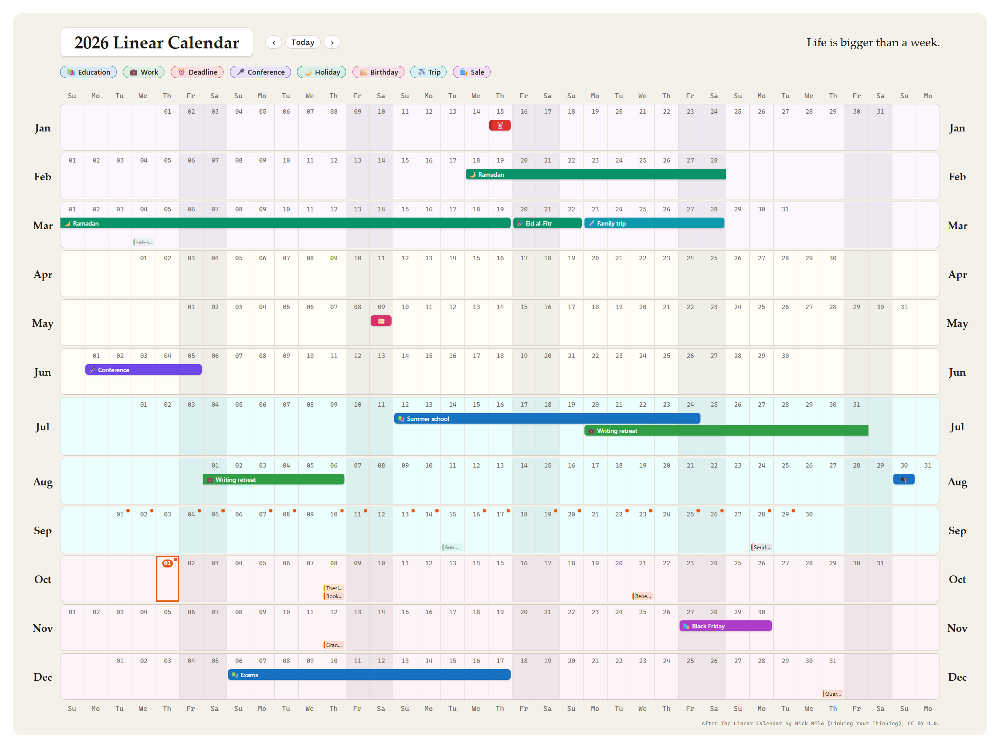
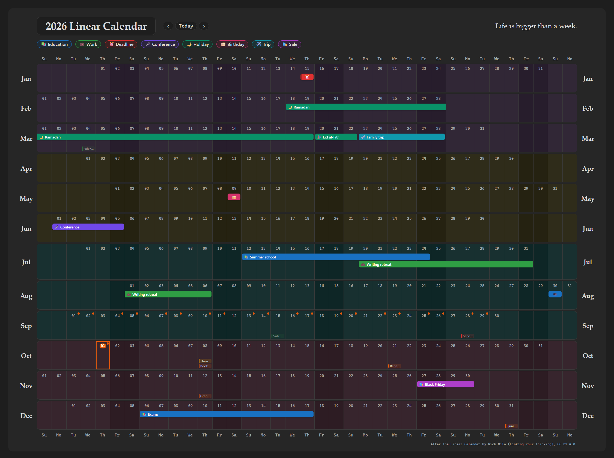

# Year Map

The whole year on one page, as a linear calendar: your daily notes,
[TaskNotes](https://github.com/callumalpass/tasknotes) tasks you can drag to reschedule, and holidays that return on
their Hijri dates. Twelve months are twelve rows with the days lined up by weekday, so that every weekend falls in
the same column down the year, and every day, month, task and plan opens with a click.

The layout follows **The Linear Calendar** by Nick Milo (see [Credit](#credit)).



## What it draws

- **Days.** A dot marks a day with a daily note. A click on a day asks what to do: add an event there, add one that
  comes back every year (a birthday, an anniversary), open the day's note (made from your template when it does not
  exist yet), or open an event on that day. Ctrl-click (Cmd-click on macOS) opens the day's note in a new tab, and a
  setting can make the click open the note or add an event at once.
- **Months and the year.** A click on a month's name opens its monthly note, and a click on the title opens the
  yearly note, when you keep them (Journals or Periodic Notes).
- **Tasks**, at the foot of their day, in the colour of their status or priority. A task that is past its due date
  and not done is marked. Drag a task onto another day to move it there.
- **Events** as bars across their days, each with its icon: any note with a start date and an end date, in a folder
  or with a tag you choose. A bar that runs into the next month continues there.
- **Kinds of event.** Each kind has a colour and an icon: Personal, Education, Work and Deadline, as in the template's
  legend, then Conference, Holiday, Birthday, Trip, Money and Sale. Change them or add your own. A legend under the
  title names the kinds the year shows.
- **Repeats.** An event that says `repeat: yearly` comes back every year from its first. With `calendar: hijri` it
  follows the Umm al-Qura calendar, the Hijri calendar of Saudi Arabia: Ramadan, the two Eids and Arafah come back
  on their Hijri dates. Umm al-Qura is computed, while Ramadan and the Eids begin when they are announced, which can
  be a day or two off it: a setting moves every day it computes, and a note can name the day a year's occurrence was
  actually observed.
- **Deadlines.** A date inside an event, such as a conference's `deadline`, is drawn as a day of its own, in the
  Deadline kind, in the year it falls in.
- **Still open.** An event whose end is `today` runs until today: a request still waiting, a project under way.
- **Quarters.** Each quarter on a tint of its own, lavender, cream, aqua and rose, as the template does it.
- **Plans.** Drag across days to plan something: name it, choose its kind, icon and repeat, and it is written as an
  event note.
- **Changes.** Right-click an event (or choose *Edit* in a day's menu) to change its name, kind, icon, days, repeat or
  colour. Only what you change is written; a note still named after its old title is renamed, its links kept. A
  setting can make a click on an event edit it, or ask, instead of opening its note.



## Opening it

- The **ribbon icon** or the command **Year Map: Open in a tab** opens the year in its own tab. The arrows move
  through the years and **Today** comes back.
- Or put a `year-map` code block in any note (the command **Year Map: Insert block** writes one):

````markdown
```year-map
```
````

A block may choose its year, title, density and layers, one per line. Anything it does not set comes from the
settings.

````markdown
```year-map
year: next
title: {year}, the thesis year
density: compact
layers: tasks, events
```
````

| Line | Values |
|---|---|
| `year:` | a year such as `2027`, or `this`, `next`, `last`, `+2`, `-1` |
| `title:` | any text; `{year}` stands for the year |
| `density:` | `comfortable` or `compact` (tasks as dots, for a narrow pane) |
| `layers:` | any of `days`, `tasks`, `events`, or `none` |

## Works with

**[TaskNotes](https://github.com/callumalpass/tasknotes).** When TaskNotes is on, the year map reads its own settings:
how it recognises a task (its tag or property), the names it gives the due, scheduled, status and priority
properties, its statuses and which of them count as completed, and their colours. A task dropped on another day is
moved by TaskNotes' own update, so its views and its notices follow. The time of day a date had is kept.

**[Journals](https://github.com/srg-kostyrko/obsidian-journals).** A day, a month and the year open through the
journals you name (Daily, Monthly and Annually by default). Journals makes a missing note from its own template, with
its own name and index. Days are read from the date Journals records in each note, whatever the note is called.

**Daily notes** (core), **[Periodic Notes](https://github.com/liamcain/obsidian-periodic-notes).** Without Journals,
the core plugin's or Periodic Notes' folder, date format and template are used. A missing note is made from the
template, with `{{date}}`, `{{date:FORMAT}}`, `{{time}}` and `{{title}}` filled in.

**Without any of them**, choose a folder and a date format in the settings. Tasks then are notes with the task tag
(`task` by default) and `due` or `scheduled` dates in their frontmatter.

**Events** are plain notes, so notes made by other plugins can be drawn too, such as Full Calendar's: a note is an
event when it is in one of the event folders (`Year Map` by default) or has one of the event tags (`event`), and it
has a start date:

```yaml
---
title: Summer school
start: 2026-07-12
end: 2026-07-24
category: Education
---
```

The first of `start`, `date` and `startDate` present is the start, and of `end` and `endDate` the end; with no end,
the event is one day. All of these names can be changed in the settings. More that a note may say:

```yaml
---
title: Ramadan
start: 2026-02-18        # one year's first day: 1 Ramadan 1447
end: 2026-03-19
category: Holiday        # its colour and icon, unless the note gives its own
icon: 🌙                 # an emoji or a few letters
repeat: yearly           # every year from 2026
calendar: hijri          # on the Umm al-Qura calendar
observed: [2027-02-09]   # if a year's Ramadan begins on another day than the one computed
---
```

```yaml
---
title: ICRA 2027
start: 2027-05-24
end: 2027-05-28
category: Conference
deadline: 2026-09-16     # drawn on 16 September 2026, in the Deadline kind
---
```

The Hijri dates come from your system's own calendar data (`Intl`, Umm al-Qura). Where a month's last day is the
30th and next year's month has 29 days, the event ends on the 29th. The **Hijri offset** setting moves every day
Umm al-Qura computes, by up to two days either way; the days a note gives stay as written. A date under `observed`
takes the place of the occurrence nearest to it (within 30 days) and keeps its length, so the list can hold a date
for each year that differed. Where your system has no Umm al-Qura calendar, an event that repeats by it is drawn only
on the days its note gives, and a line above the grid says so.

## Why not Linear Calendar, Yearly Glance, or TaskNotes' Year view

Each does its own job well; which to choose depends on what you keep in your vault.

- **Linear Calendar** draws all 365 days from your notes' date properties, lets you drag across days to make a
  multi-day note, and repeats notes. Year Map draws the same kind of year and adds TaskNotes' tasks, which you drag
  to another day, days that open through Journals, and repeats on the Hijri calendar. Without TaskNotes, Journals
  or Hijri dates, Linear Calendar may be all you need.
- **Yearly Glance** keeps annual events and birthdays in view, with the Chinese lunar calendar built in and an
  interface in English and Chinese. Year Map does for the Hijri calendar what Yearly Glance does for the Chinese
  one, and puts your tasks and daily notes on the same page; its own interface is in English only.
- **TaskNotes' Year view** shows your tasks across the year as twelve month grids. Year Map lays the year out as
  twelve rows lined up by weekday, draws your plans and events as bars beside the tasks, and moves a task you drag
  through TaskNotes' own update, so your tasks stay TaskNotes'.

## Settings

| Setting | Default | What it does |
|---|---|---|
| Block name | `year-map` | The code block's language. A change takes effect when the plugin is reloaded. |
| Title, Line under the title | `{year}`, none | The head of the page; `{year}` stands for the year. |
| Week starts on | Sunday | The first column. |
| Weekend | Saturday and Sunday | The columns shaded down the year; Friday and Saturday, or one day, or none. |
| Density | Comfortable | Compact draws tasks as dots. |
| Tasks shown on a day | 3 | More are counted. |
| Event rows in a month | 3 | Events beyond these are counted on their days. |
| A click on a day | Shows a menu | Or opens the day's note, or adds an event. A right-click always shows the menu. |
| A click on an event | Opens its note | Or edits it, or asks which. A right-click always asks. |
| Legend | on | The kinds of event the year shows, under the title. |
| Tint each quarter, and the four tints | on; lavender, cream, aqua, rose | As in the Linear Calendar template. |
| Show daily notes | on | |
| Daily notes from | Found by the plugin | Journals, Daily notes or Periodic Notes, or a folder and a date format. |
| Daily, Monthly and Yearly journal | Daily, Monthly, Annually | The Journals journals that open a day, a month and the year. |
| Show tasks | on | |
| Date a task sits on | Scheduled, or due when not scheduled | Or due, or scheduled, or both. |
| Hide completed tasks | off | |
| Drag to reschedule | on | |
| Colour tasks by | Status | Or priority. |
| Task tag and property names | `task`, `due`, `scheduled`, `status`, `priority` | Used only without TaskNotes. |
| Show events | on | |
| Event folders, Event tags | `Year Map`, `event` | What makes a note an event. |
| Start, End and Colour properties | `start, date, startDate`, `end, endDate`, `color` | |
| Default colour | orange | For an event with none. |
| Kinds of event | ten kinds | One per line: `Name, #colour, icon`. |
| Kind, Icon, Repeat and Calendar properties | `category`, `icon`, `repeat`, `calendar` | |
| Hijri offset | As Umm al-Qura computes | Moves every day the Hijri calendar computes, up to two days earlier or later. |
| Observed property | `observed` | Dates a repeating event was observed on instead of the days computed. |
| Dates inside an event, and their kind | `deadline`; Deadline | Each drawn as a day of its own. |
| Folder for new events | `Year Map` | Where a plan made on the grid is written. |
| Properties for new events, Text of a new event | none | Frontmatter lines and a body for every new plan, such as a parent note or a heading. `{{title}}`, `{{start}}`, `{{end}}` and `{{now:FORMAT}}` are filled in. |

## Installing

From **Settings → Community plugins**, once it is listed there. Until then, download `main.js`, `manifest.json` and
`styles.css` from the [latest release](https://github.com/asmbatati/year-map/releases/latest) into
`<your vault>/.obsidian/plugins/year-map/`, then turn it on under **Settings → Community plugins**. It needs Obsidian
1.13 or later.

## Developing

```bash
npm ci
npm test          # the model, the renderer and the plugin, in Node, against a stub of Obsidian
npm run lint      # eslint with eslint-plugin-obsidianmd
npm run build     # type-check and bundle main.js
node docs/demo/build.mjs --shots   # the demo page and the two screenshots, with headless Edge or Chrome
```

## Credit

The layout follows **The Linear Calendar** © Nick Milo ([Linking Your Thinking](https://www.linkingyourthinking.com)),
licensed under [CC BY 4.0](https://creativecommons.org/licenses/by/4.0/). This plugin redraws that layout in HTML and
CSS and adds days, tasks and events to it; no file of the original is included. Every year map carries the credit in
its corner.

## License

[MIT](LICENSE) © 2026 Abdulrahman S. Al-Batati
